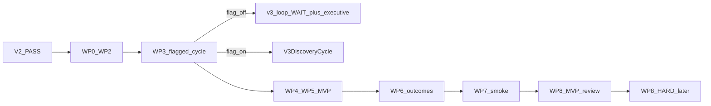

# V3 Discovery and Building — God Mode Execution Plan (Fast Experimental Build)

Version: 2.0
Status: FAST EXPERIMENTAL BUILD — implementation blocked until canonical V2 acceptance only
Date: 2026-08-22
Design branch: `candidate/v3-discovery-design`
Design HEAD: `5cd0b88` (repair of `c723107`)
Worktree: `C:\temp\JARVIS-V3-Discovery-Design`

## Overview

Fast experimental build plan for V3 Discovery and Building. Keeps the WP0–WP8 architecture and evidence discipline, but removes ceremony that slows iteration.

**Hard entry gate:** V2 canonical acceptance on `main` only.

**Test rule (every WP):** Record the canonical baseline suite at V2 merge. After each WP, run the full suite and require **zero new failures introduced by V3**. All new `test_v3_*` tests must pass. Pre-existing baseline failures are recorded but do not block MVP unless V3 makes them worse.

**Orchestration rule:** `v3_loop` honest WAIT is **preserved** as the fallback when `discovery.cycle_enabled=false`. WP3 adds `V3DiscoveryCycle` behind the flag; it does not delete the WAIT path.

**Acceptance split:** MVP gate first (one focused review). Full AC-01..AC-20 hardening deferred to a later pass.

---

## Execution checklist

- [ ] **Phase 0:** V2 canonical PASS on `main`; record baseline suite manifest + `CANONICAL_V2_SCHEMA_VERSION` / `V3_SCHEMA_VERSION`
- [ ] **Phase 0:** Create `C:\temp\JARVIS-V3-Implementation` on `candidate/v3-implementation` from V2 merge SHA
- [ ] **Phase 1 WP0:** Fixtures (policy JSON, v35 baseline DB, bare remote helper)
- [ ] **Phase 1 WP1:** v36 migration, projections, `candidate_outcomes` / `scoring_policy_registry`
- [ ] **Phase 1 WP2:** `ScoringService`, hard filters, ELIGIBLE portfolio, determinism tests
- [ ] **Phase 1 PR:** WP0+WP1+WP2; baseline delta = 0 new failures; `discovery.cycle_enabled=false`
- [ ] **Phase 2 WP3:** `V3DiscoveryCycle` behind flag; **keep** `v3_loop` WAIT fallback; wire `worker_loop` dual-path
- [ ] **Phase 3:** WP4 teams/verifier basics + WP5 disposable Git reconcile (parallel, MVP scope)
- [ ] **Phase 4 WP6:** Outcome recording (immediate window); maintenance hook stub OK for MVP
- [ ] **Phase 5 WP7:** Defer exhaustive fault matrix to hardening; MVP gets STOP/restart smoke only
- [ ] **Phase 6 WP8-MVP:** MVP gate pass + **one focused review** (not triple verification)
- [ ] **Later WP8-HARD:** Full AC-01..AC-20, soak, fault matrix, independent verifier depth

---

## Current state (verified)

| Item | Value |
|------|-------|
| Design branch | `candidate/v3-discovery-design` |
| Design HEAD | `5cd0b88` |
| Implementation authorized | **NO** until V2 canonical PASS |
| Schema rule | `V3_SCHEMA_VERSION = CANONICAL_V2_SCHEMA_VERSION + 1` (expected v36) |
| V2 occupies | v35 at `f1660f6` |

**Core architectural bet:** Add `V3DiscoveryCycle` as an opt-in unified path when `discovery.cycle_enabled=true`. When false, production keeps today's split: `v3_loop` observes then **WAITs**; `ExecutiveDecisionService` selects via `worker_loop`. No parallel schedulers or evidence stores.

### Phase flow (ASCII — use this in PDF)

```text
Phase 0 — V2 canonical PASS (ONLY hard gate)
  → record baseline suite + schema versions
        ▼
Phase 1 — WP0 → WP1 → WP2  (foundation; flag OFF)
        ▼
Phase 2 — WP3: V3DiscoveryCycle behind flag
          ├─ flag ON  → unified observe→select→compile
          └─ flag OFF → v3_loop WAIT + executive select (unchanged fallback)
        ▼
Phase 3 — WP4 + WP5 parallel (MVP scope)
Phase 4 — WP6 outcomes (immediate window)
Phase 5 — WP7 STOP/restart smoke (full battery → later)
        ▼
Phase 6 — WP8-MVP gate → one focused review → experimental MVP
        ▼
Later   — WP8-HARD (AC-01..20, soak, fault matrix, deep verifier)
```

### Phase flow (compact graph)



---

## Test baseline rule (binding)

Every WP uses the same comparison, not an unconditional full-suite green requirement.

| Step | Action |
|------|--------|
| 1 | At V2 merge, run `pytest tests/foundry/ -q` and save `evidence/v3/impl/BASELINE_SUITE.json` (pass/fail/skip counts + failing node ids) |
| 2 | After each WP, run the same command |
| 3 | **PASS** if: (a) no new failing tests vs baseline, (b) all new `test_v3_*` tests pass, (c) reconcile drift = 0 when projections touched |
| 4 | Record delta in `evidence/v3/impl/WP{n}_SUITE_DELTA.json` |

Pre-existing baseline failures are listed in the manifest. V3 must not increase the failure set.

---

## Poteto throughput checkpoint

| Dimension | Plan |
|-----------|------|
| **Blocking first steps** | V2 canonical PASS only. Then baseline manifest + worktree. |
| **Independent workstreams** | WP4 and WP5 parallel after WP3. WP6 after WP2+WP3. |
| **Shared mutable state** | Serialize WP1→WP2→WP3. No parallel writes to `migrations.py` / `projections.py`. |
| **Smallest safe decomposition** | First PR = WP0+WP1+WP2. MVP review after WP8-MVP, not per-WP triple verify. |

---

## Phase 0 — Hard gate (V2 only)

**Goal:** Freeze baseline. No `src/` until V2 is canonical.

**Actions:**

1. V2 independent PASS + merge to `main`.
2. Run baseline suite; save `BASELINE_SUITE.json`.
3. Record `CANONICAL_V2_SCHEMA_VERSION` and `V3_SCHEMA_VERSION = N + 1`.
4. Create implementation worktree from V2 merge SHA.

**Stop condition:** V2 not on `main`.

**Evidence:** `evidence/v3/impl/V3_ENTRY_BASELINE.json`

---

## Phase 1 — Foundation (WP0 + WP1 + WP2)

**Goal:** Typed candidates, v36 schema, deterministic scoring. Flag stays OFF.

### WP0 — Fixtures

| Deliverable | Path |
|-------------|------|
| Scoring policy fixture | `tests/fixtures/v3/policy_v3-policy-2026-08-21.json` |
| v35 baseline DB fixture | `tests/fixtures/v3/v35_baseline.db` or generator |
| Bare remote helper | `tests/fixtures/v3/bare_remote/` |

### WP1 — Schema v36 + projections

Migration at `V3_SCHEMA_VERSION` only (never v35). Tables: `candidate_outcomes`, `scoring_policy_registry`, `discovery_portfolio`. Extend `candidates` columns.

**Verify:** reconcile drift = 0; `test_v3_projections.py` pass.

### WP2 — Scoring + portfolio

`ScoringService`, hard filters, ELIGIBLE state, unified `min_total_score=0.40`.

**Verify:** `test_v3_scoring.py` determinism; baseline delta = 0.

**PR boundary:** One PR. `discovery.cycle_enabled=false`. Baseline delta = 0.

---

## Phase 2 — Orchestrator (WP3) — flagged, fallback preserved

**Goal:** Add unified cycle behind flag. **Do not remove `v3_loop` WAIT.**

| Mode | `discovery.cycle_enabled` | Behavior |
|------|---------------------------|----------|
| **Fallback (default)** | `false` | `v3_loop.run_one_loop` observes → honest **WAIT**; `ExecutiveDecisionService` selects in `worker_loop` (current production split) |
| **Experimental** | `true` | `V3DiscoveryCycle` runs observe → score → select → compile in one cycle record |

| Component | Responsibility |
|-----------|----------------|
| `V3DiscoveryCycle` | Unified path when flag ON |
| `MissionCompiler` | Fail-closed materialization |
| `runtime/worker_loop.py` | Branch on flag: cycle vs executive-only |
| `v3_loop.py` | **Keep** WAIT return when flag OFF; `test_legacy_selection` remains for regression |

**Verify:**

- Flag OFF: `test_v3_loop.py` WAIT behavior unchanged
- Flag ON: `test_v3_discovery_cycle.py` one lab loop
- No duplicate `mission.created` per fingerprint

**Rollback:** Set `discovery.cycle_enabled=false` → immediate return to `v3_loop` WAIT + executive selection. No code revert required.

**Verify suite:** baseline delta = 0.

---

## Phase 3 — Parallel MVP surfaces (WP4 + WP5)

### WP4 — Teams/verifier (MVP scope)

- Fresh verifier session on MVP path
- Repair budget = 3
- Defer delegation-depth exhaustive tests to WP8-HARD

### WP5 — Disposable Git reconcile (MVP scope)

- `GitEffectAdapter` with `ls-remote` check
- One disposable bare-remote push/pull proof
- Defer ambiguous-timeout full matrix to WP8-HARD

**Verify:** `test_v3_git_reconcile.py` pass; baseline delta = 0.

---

## Phase 4 — Outcomes (WP6) — MVP scope

- `OutcomeService` immediate window only (7d/30d → WP8-HARD)
- Wire `discovery.candidate_outcome_recorded` → `candidate_outcomes`
- Maintenance scan may stub wake for MVP

**Verify:** `test_v3_outcomes.py` pass; baseline delta = 0.

---

## Phase 5 — Smoke hardening (WP7) — MVP scope

**MVP only:**

| Check | Scope |
|-------|-------|
| STOP blocks new dispatch | smoke test |
| Restart mid-cycle resumes once | 2 injection points |
| Projection rebuild | reconcile = 0 |

**Deferred to WP8-HARD:** 12-point crash matrix, full AC-07 races, AC-16 injection battery, AC-19 migration interrupt+restore marathon.

**Verify:** `test_v3_smoke.py` pass; baseline delta = 0.

---

## Phase 6 — Acceptance (WP8)

### WP8-MVP gate (ship experimental MVP)

| # | Criterion | Test |
|---|-----------|------|
| M1 | Schema + projections rebuild | `test_v3_projections.py` |
| M2 | Deterministic scoring | `test_v3_scoring.py` |
| M3 | One discovery-to-mission loop (flag ON, lab) | `test_v3_discovery_cycle.py` |
| M4 | Duplicate prevention | `test_v3_dedup.py` |
| M5 | Basic STOP + restart | `test_v3_smoke.py` |
| M6 | Disposable Git reconciliation | `test_v3_git_reconcile.py` |
| M7 | Outcome recording | `test_v3_outcomes.py` |
| M8 | Baseline delta = 0 | `BASELINE_SUITE.json` compare |

**MVP review:** **One focused review** covering M1–M8 evidence bundle. Not a triple independent verifier round. Record verdict in `evidence/v3/impl/MVP_REVIEW.json`.

**Deliverables:**

- `var/evidence/v3-mvp/MVP_GATE_REPORT.json`
- `evidence/v3/impl/MVP_REVIEW.json` (single reviewer, PASS/FAIL)

**Promotion:** Experimental only. `discovery.cycle_enabled` stays OFF in production until WP8-HARD PASS.

### WP8-HARD (later — not required for experimental MVP)

| Area | Content |
|------|---------|
| Full acceptance | AC-01..AC-20 per [`05_V3_ACCEPTANCE_GATE.md`](05_V3_ACCEPTANCE_GATE.md) |
| Soak | 4h lab (or 24h if owner extends) |
| Fault matrix | 12 injection points, STOP races, tamper detection |
| Verifier depth | Independent adversarial session (Hermes authority) |
| Security/migration | AC-16, AC-19 full rehearsals |
| Promotion packet | Release Captain integration + rollback rehearsal |

---

## Principle-to-decision map (revised)

| Principle | Decision |
|-----------|----------|
| **Sequence Verifiable Units** | Baseline delta per WP, not full-suite green mandate |
| **Fix Root Causes** | Unified cycle behind flag; WAIT fallback preserves proven path |
| **Subtract Before You Add** | Reuse `v3_loop` WAIT; don't delete working fallback |
| **Prove It Works** | MVP gate proves one loop; hardening proves the rest later |
| **Experience First** | Ship experimental MVP fast; harden when loop is real |

---

## Risk register

| Risk | Mitigation |
|------|------------|
| V2 delayed | Design-only; no `src/` |
| Flag ON breaks production | Default OFF; WAIT fallback always available |
| Baseline has pre-existing failures | Delta rule, not absolute green |
| Skipping hardening too long | WP8-HARD explicitly scheduled; MVP cannot promote to prod |

---

## What this plan does NOT do

- Implement before V2 canonical PASS
- Remove `v3_loop` WAIT fallback
- Require unconditional full-suite EXIT=0 at every WP
- Require triple independent verification for MVP
- Enable `discovery.cycle_enabled` in production before WP8-HARD
- Touch production, Hermes sessions, or live DB for MVP proof

---

## Success definition

### MVP success (experimental)

```text
VERDICT: MVP_PASS
ENTRY:   V2 canonical on main; baseline manifest recorded
EXIT:    M1–M8 pass; baseline delta = 0; one focused review PASS
SCOPE:   One discovery-to-mission loop with flag ON in lab;
         flag OFF fallback (v3_loop WAIT + executive) unchanged
REVIEW:  Single focused review — not triple verification
```

### Full success (later hardening)

```text
VERDICT: HARD_PASS
EXIT:    AC-01..AC-20; independent verifier; soak; promotion packet
```

**First action when V2 PASS fires:** Phase 0 baseline record → Phase 1 PR (WP0+WP1+WP2).

---

## Related documents

| File | Role |
|------|------|
| [`00_V3_READ_FIRST.md`](00_V3_READ_FIRST.md) | Entry, schema rule §7a |
| [`01_V3_DISCOVERY_BUILDING_SPEC.md`](01_V3_DISCOVERY_BUILDING_SPEC.md) | Full architecture (unchanged) |
| [`04_V3_WORK_PACKAGES.md`](04_V3_WORK_PACKAGES.md) | WP detail reference |
| [`05_V3_ACCEPTANCE_GATE.md`](05_V3_ACCEPTANCE_GATE.md) | Full AC-01..AC-20 (WP8-HARD target) |
